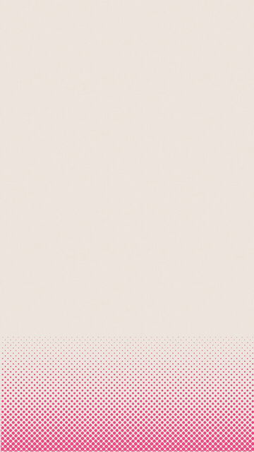
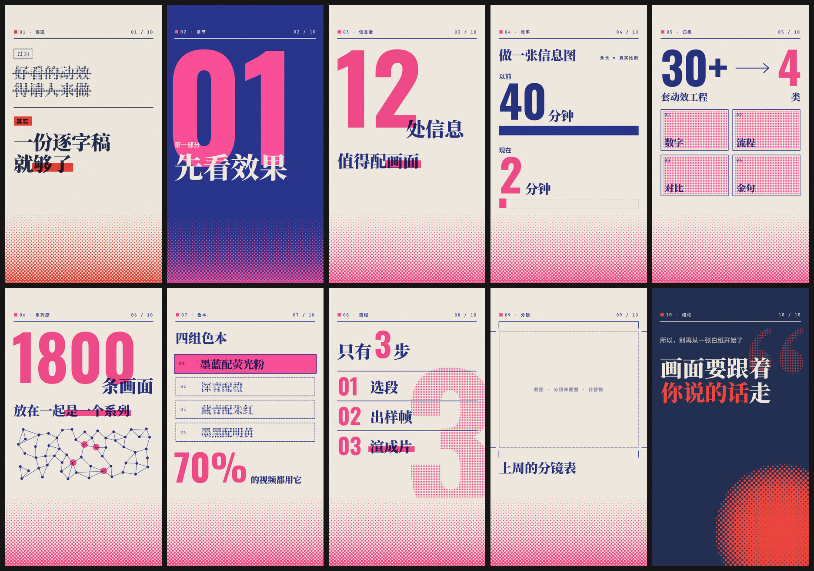

# eian-riso-broll

**Risograph-style info animations for talking-head videos · a Claude Code skill**

[中文](README.md) · English

Hand Claude the script of your talking-head video. It picks the lines worth visualizing and turns them into vertical info animations (1080×1920 mp4) in a two-color risograph print style, ready to drop into your editor.

| Big number | Many → few | Before / after | Key quote |
|:---:|:---:|:---:|:---:|
|  |  |  |  |

Ten animations made from one minute of script (the last frame of each):



> The copy comes from a [fictional sample script](examples/demo-script.md) (in Chinese); every word on screen is lifted from what's said. GIFs are compressed; the real output is 30fps HD mp4.

## Who it's for

Creators who make talking-head, explainer or knowledge videos for short-video platforms. While your viewers hear you, this skill makes them **see** the number, the comparison or the conclusion you're talking about.

- **You give**: the script (an SRT subtitle file makes timing exact).
- **You get**: one mp4 per animation (picture only, no audio), a storyboard table and a contact sheet of every shot. A transparent version is available when you want to overlay it on your footage.

The typography is designed for Chinese (serif display type, Chinese line limits). Latin text renders fine too.

## Why use it

- **A series, not a pile of slides**: all ten templates share one paper, one pair of inks, one set of fonts and one header, so a whole episode looks consistent.
- **Timed to your voice**: each animation lasts as long as the line it covers; with subtitles, it's matched to the exact in and out points.
- **Never makes things up**: on-screen text is only ever cut from your own words. Categories or figures you didn't say stay blank; without a real screenshot you get a "to be replaced" placeholder, never a fake UI.
- **Approve before rendering**: you see a storyboard first, then a still of every shot, and only then does it render, so changes stay cheap.
- **Built for vertical video**: it keeps clear of the platform's top bar, the subtitle area and the like/comment buttons on the right, and automatically checks type size, contrast and anything running off-frame.
- **Free, offline, local**: no image-generation models, no network. Fonts are bundled, so macOS, Windows and Linux render identically.

## Install

You'll need:

- [Claude Code](https://claude.com/claude-code)
- [Node.js](https://nodejs.org) 22 or newer
- Chrome (Edge or Chromium also work)
- [ffmpeg](https://ffmpeg.org) (on macOS: `brew install node ffmpeg`)

Put the skill in Claude Code's skills folder and run the setup check:

```bash
git clone https://github.com/YIAN6557/eian-riso-broll.git ~/.claude/skills/eian-riso-broll
node ~/.claude/skills/eian-riso-broll/scripts/check_setup.mjs
```

When it says everything passed, you're ready. On Windows, use `%USERPROFILE%\.claude\skills` instead of `~/.claude/skills`.

## How to use it

Just ask Claude, for example:

- **A whole episode**: "Use eian-riso-broll to make info animations for this script: … (paste the script)"
- **A single line**: "Turn this line into a Riso animation and render it straight away: 'Making one infographic used to take 40 minutes; now it takes 2.'"
- **Matched to your voice**: "Here's my subtitle file talk.srt. Animate the third paragraph and match its length to the voiceover."
- **For overlaying**: "Give me a transparent-background version of the last one."

For a whole episode, Claude works in three steps and stops for your OK after each:

1. **Storyboard**: which line gets which visual, the exact on-screen text and the duration. This is the cheapest moment to drop or swap shots.
2. **Stills**: the last frame of every animation, laid out on one sheet. Fix layout or wording here.
3. **Final render**: the mp4s, checked again for length and size.

If you give it a single line or say "render it straight away", Claude merges the steps, but never skips the checks.

Finished files go to `~/eian-riso-broll-projects/<project name>/renders/`, one mp4 per animation.

## The ten templates

Numbers match the contact sheet above.

| # | Template | Use it when | Line from the sample |
|---|---|---|---|
| 01 | Myth vs. fact `versus` | "Most people think… actually…" | Good motion graphics need a hired animator → a script is enough |
| 02 | Chapter card `title` | Part one, part two…; an opening title | Part one: see the results |
| 03 | Big number `number` | One number strong enough to fill the frame | 12 lines worth visualizing |
| 04 | Before / after `compare` | Two values of the same thing, bars drawn to true scale | 40 minutes before, 2 minutes now |
| 05 | Many → few `converge` | Lots of things narrowing down to a few | 30-plus projects → 4 kinds |
| 06 | Network `network` | A count plus connection, relationships or scale | 1,800 shots that read as one series |
| 07 | Pick one `focus` | Several options with one highlighted | Four palettes; 70% of videos use the first |
| 08 | Steps `steps` | 2–6 steps in order | Just 3 steps: pick lines, check stills, render |
| 09 | Screenshot `shot` | Viewers need to see the real thing (dashboard, post, spreadsheet) | Last week's storyboard (you supply the screenshot) |
| 10 | Key quote `quote` | The hook or the conclusion, on a full dark background | Visuals should follow what you say |

## Four palettes

| Palette | Mood |
|---|---|
| Ink blue × fluorescent pink (default) | The most "risograph"; knowledge, tech |
| Deep teal × orange | Warm; methods, lifestyle |
| Navy × vermilion | Opinions, myths, warnings |
| Ink black × bright yellow | Restrained; serious topics, data, finance |

Use at most two per episode: one for the body, one for the opening and closing. To change colors, just tell Claude.

## What it doesn't do

- **No sound**: output is picture only. Voice, sound effects and music stay in your editor.
- **No non-informational shots**: emotional monologues, storytelling, metaphors and software walkthroughs are better served by live footage, character animation or screen recording. Claude will tell you so.
- **No fake screenshots**: anything that needs to show the real thing needs a real screenshot from you.
- **Vertical only, for now**: 1080×1920.

## FAQ

**How long does rendering take?**
On an Apple Silicon Mac, a 5-second animation takes about 15–20 seconds. Stills take a few seconds each.

**Can I edit the text myself?**
Yes. Each animation is an html file under `compositions/` in the project. Open it in a browser to preview (it loops). Edit the `DATA` block at the top, then ask Claude to render again.

**What if the text is too long?**
Claude cuts words from what you said rather than shrinking the type; text too small to read on a phone might as well not be there.

**Why do a few characters look different?**
The bundled Chinese fonts cover the 6,763 most common characters; rare ones fall back to a system font.

**It says Chrome can't be found.**
Set `CHROME=<path to the browser executable>` and try again; `check_setup.mjs` tells you exactly what went wrong.

## Manual use, without Claude

```bash
cd ~/.claude/skills/eian-riso-broll
P=$(node scripts/new_project.mjs episode-12)                 # create a project, prints its path
cp templates/number.html "$P/compositions/01-number.html"    # copy a template, edit DATA at the top
node scripts/render.mjs "$P"/compositions/*.html --still     # stills + contact sheet
node scripts/qa.mjs     "$P"/compositions/*.html             # automatic checks
node scripts/render.mjs "$P"/compositions/*.html             # final mp4s
node scripts/render.mjs "$P/compositions/01-number.html" --alpha   # transparent (ProRes 4444)
```

More detail (in Chinese): [references/production.md](references/production.md).

## Want to change the skill?

Code layout, the self-test and the maintenance scripts are in [CONTRIBUTING.md](CONTRIBUTING.md).

## Credits and license

- Code and docs in this repository: see [LICENSE](LICENSE).
- Animation engine [GSAP](https://gsap.com) (`assets/gsap.min.js`): GreenSock's Standard License, free for commercial use, and not covered by this repository's license.
- Bundled fonts: Noto Serif SC, Noto Sans SC, Oswald and JetBrains Mono, all under the SIL Open Font License; see [assets/fonts/](assets/fonts/).
- Ideas in the workflow (three approval gates, only quoting the speaker's own words) were inspired by gbro-collage-info.
