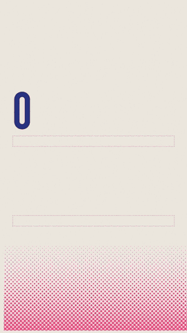
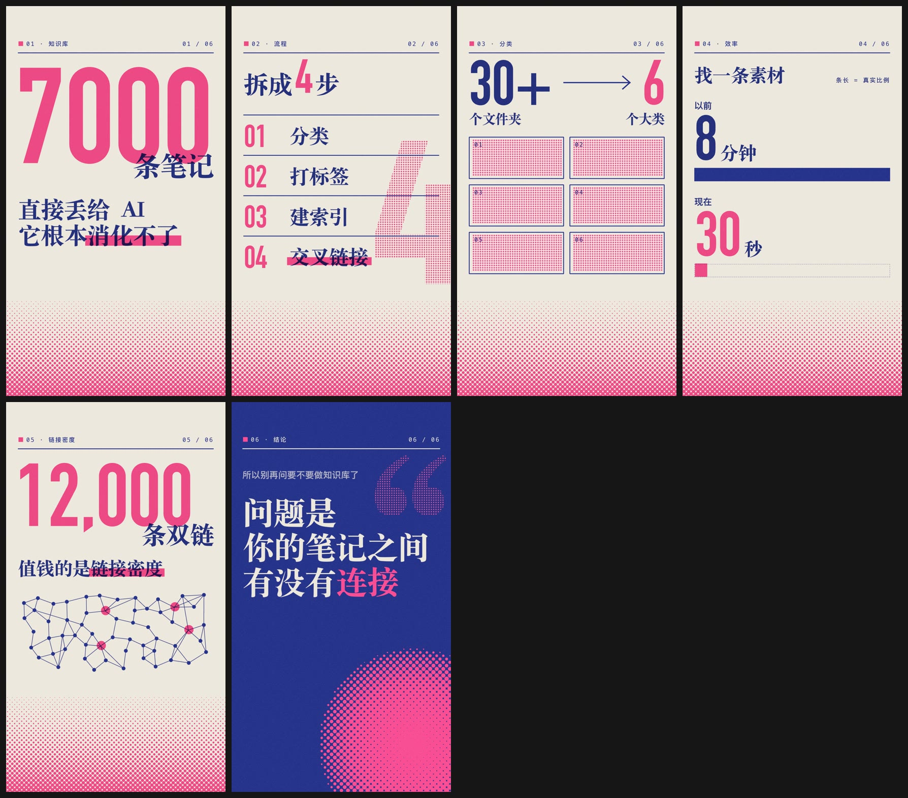

# eian-riso-broll · 孔版双色信息 B-roll

给一份口播逐字稿，挑出适合做成信息动画的段落，产出 1080×1920 竖屏 mp4（只有画面，不带音轨）。纯 HTML/CSS/GSAP，本机 Chrome 逐帧渲染，**零 npm 依赖、不调用任何图片生成模型**。

| 数字冲击 | 收敛归类 | 前后对比（真实比例） | 金句（满版深底） |
|---|---|---|---|
|  |  |  |  |

> GIF 已压缩；成片是 30fps H.264，不带音轨（声音统一在剪辑台处理）。demo 文案全部来自同一段测试逐字稿（“很多人以为做知识库就是把笔记堆进去…”）。

一条视频的 6 个末帧（暂停即海报）：



10 个模板：


## 风格

一张纸，两种专色油墨：

- **A 墨**（深）负责所有要读的字和结构线；**B 墨**（荧光）一帧只做一处重点。
- 两墨正片叠底：重叠处自动出现第三色。
- B 版整版 3px 套印错位；所有“渐变”都用网点。
- 动画就是“这张海报被印出来的过程”：网点显影、套印归位、盖章砸落、滚筒刷过、铅字升起。
- 宋体 Black 做标题，DIN Condensed 做数字。四组色本：墨蓝×荧光粉、深青×橙、藏青×朱红、墨黑×明黄。

## 和常见“AI 信息动画”不一样的地方

| | |
|---|---|
| **模板，不是手写** | 10 个可直接渲染的模板，只改 `DATA`；版面按字数自动排（`fit` / 按字形墨迹对齐） |
| **样帧 = 成片末帧** | 同一个文件、同一个 seek 渲出来，结构上一致 |
| **自动质检** | 安全区、短视频右侧按钮栏、字号、对比度、文字互压、成片时长与尺寸；输出带红框的叠层图 |
| **时长跟着口播** | `timing.mjs` 从 SRT 里找到那句话的入点出点，或按语速估算 |
| **不编内容** | 屏幕字只从原话里摘；台词没给的类别名留空；没有真截图就只放“待替换”占位 |

## 安装

```bash
git clone <本仓库> ~/.claude/skills/eian-riso-broll
~/.claude/skills/eian-riso-broll/scripts/check_setup.sh
```

依赖：Node ≥ 22、Chrome/Chromium、ffmpeg。macOS 自带字体效果最好。

## 使用

对 Claude 说：

- 「用 eian-riso-broll 给这期逐字稿做信息动画：……」→ 选段表 → 样帧 → 成片
- 「把这句做成 Riso 动画，直接出片：『以前找一条素材要 8 分钟，现在 30 秒』」

手动：

```bash
P=$(scripts/new_project.sh 2026-10-07-知识库)
cp templates/number.html $P/compositions/01-7000.html     # 改 DATA
node scripts/render.mjs $P/compositions/*.html --still      # 样帧 + contact sheet
node scripts/qa.mjs     $P/compositions/*.html              # 质检
node scripts/render.mjs $P/compositions/*.html              # 成片
node scripts/render.mjs $P/compositions/01-7000.html --alpha   # 透明底 ProRes 4444
```

浏览器直接打开任意 composition 即可预览（循环播放，`?t=end` 定格）。

## 结构

```
SKILL.md                 流程编排：三道门、硬规则、常见坑
references/
├── copy.md              选段与文案提炼（只摘原话、字数上限、时长）
├── templates.md         10 个模板的用途、故事、DATA 字段 + 选择树
├── style.md             视觉系统：纸、两墨、叠印、网点、色本、版面、字体、禁区
├── motion.md            动效原则 + riso.js API
└── production.md        渲染器、质检、交付、排错
templates/               number steps converge compare network quote focus versus title shot
assets/
├── riso.css             全部样式与色本
├── riso.js              动效库（时间轴 helper、网点画布、版面自检）
└── gsap.min.js          GSAP 3（GreenSock 标准许可，免费商用）
scripts/
├── render.mjs           逐帧渲染 → mp4 / mov / 样帧 / contact sheet（自带 CDP 驱动）
├── qa.mjs               质检 + 叠层图
├── timing.mjs           口播时长（SRT 精确定位 / 语速估算）
├── new_project.sh       新建自包含项目
├── check_setup.sh       环境自检
└── lib/chrome.mjs       headless Chrome 驱动（Node 自带 WebSocket）
evals/evals.json         行为评测
demo/                    GIF 与末帧一览
```
